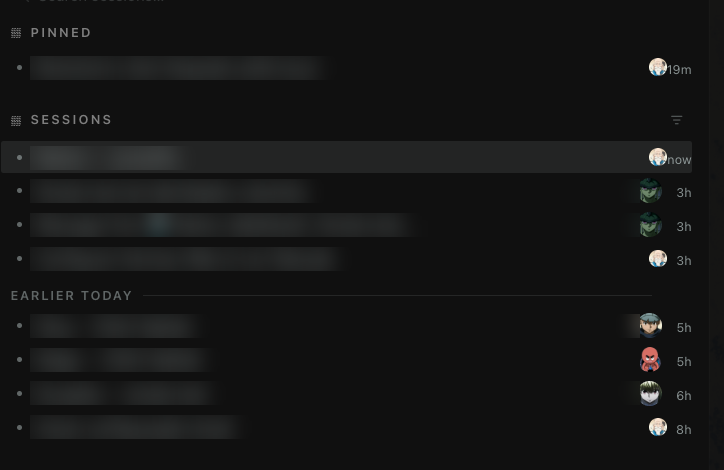
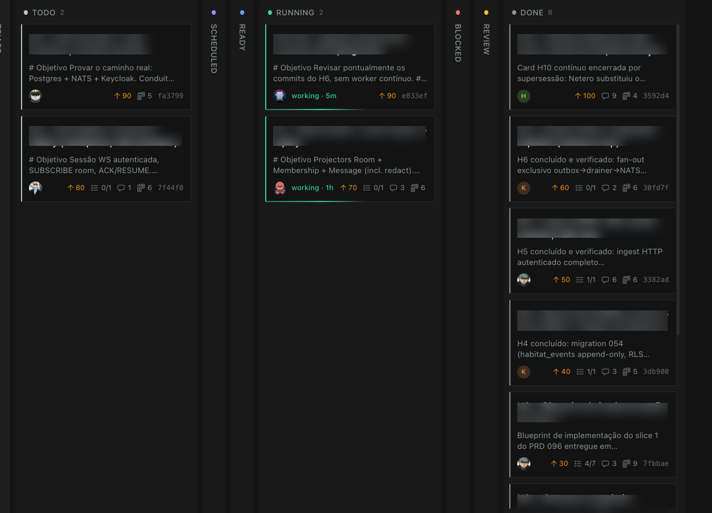

# Hermes Profile Avatars

A [Hermes Agent](https://github.com/NousResearch/hermes-agent) desktop plugin that puts **real profile avatars** everywhere the app normally shows initials — kanban card assignees, the session sidebar profile chips, and agent identity marks.

 

## Screenshots

Real avatars in the session sidebar (owner chips + inter-agent participant stack) and kanban card assignees — titles blurred to keep conversation names private:





## Problem

Hermes shows a profile's identity as a **colored initial chip** (`K`, `G`, `I`, …) in two core surfaces:

- **Kanban cards** — the assignee avatar on each card is `Avatar` → initials
- **Session sidebar** — the owning-profile chip is `ProfileGlyph` → initials

That's compact by design, but when your profiles are named bots with real avatars (e.g. a Hunter × Hunter council), the roster reads much better with the actual face.

## What it does

Watches the DOM (MutationObserver) for the two identity marks the core renders:

| Core surface | DOM hook |
|---|---|
| Kanban `Avatar` | `span[title="<profile>"]` |
| Session `ProfileGlyph` | `[aria-label="Profile: <profile>"]` |

and swaps them for the profile's real avatar via `profiles.get_asset` when one exists. Falls back to the original initial chip otherwise.

**No core patches. No rebuild. Plain desktop plugin** — hot-reloaded by the app.

## Install

```bash
git clone https://github.com/NousResearch/Hermes-Profile-Avatars ~/.hermes/desktop-plugins/profile-avatars
```

(or drop `plugin.js` into `~/.hermes/desktop-plugins/profile-avatars/`)

Then reload plugins in the desktop app: **⌘K → "Reload desktop plugins"** (or restart the app).

### Requirements

- Hermes desktop app with the plugin SDK (any recent build)
- Profile avatars stored server-side via `profiles.set_asset` (the Bot Mode plugin, `hermes-bots`, does this automatically — or put `assets/avatar.png` in each profile dir)

## How avatars get set

The plugin reads avatars from the **profile asset store** (`profiles.get_asset` → `assets/avatar.png`). You can set them with:

```bash
# via the Hermes Bot Mode plugin UI (right-click bot → Edit Profile → avatar)
# or programmatically:
hermes profile create my-bot
cp face.png ~/.hermes/profiles/my-bot/assets/avatar.png
```

## Development

```bash
# live edit — the app hot-reloads plugin.js on save
$EDITOR ~/.hermes/desktop-plugins/profile-avatars/plugin.js
```

## License

MIT © Perstein
